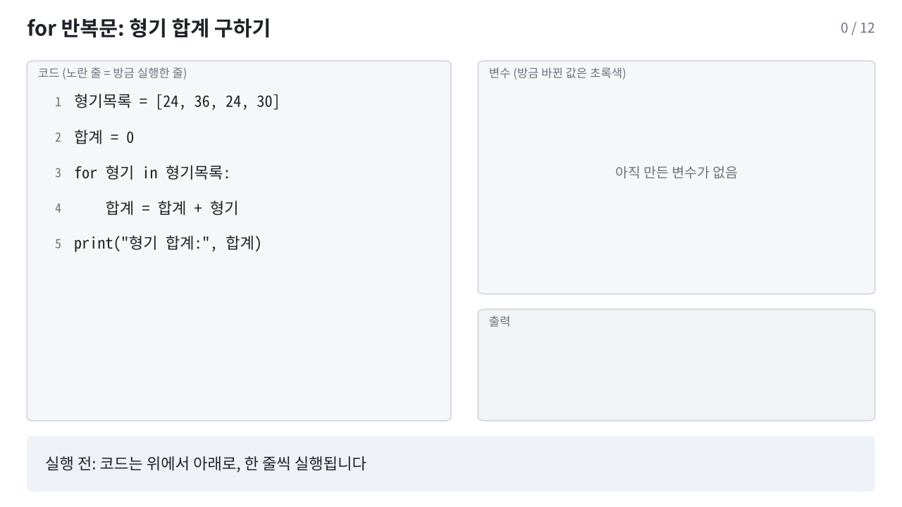
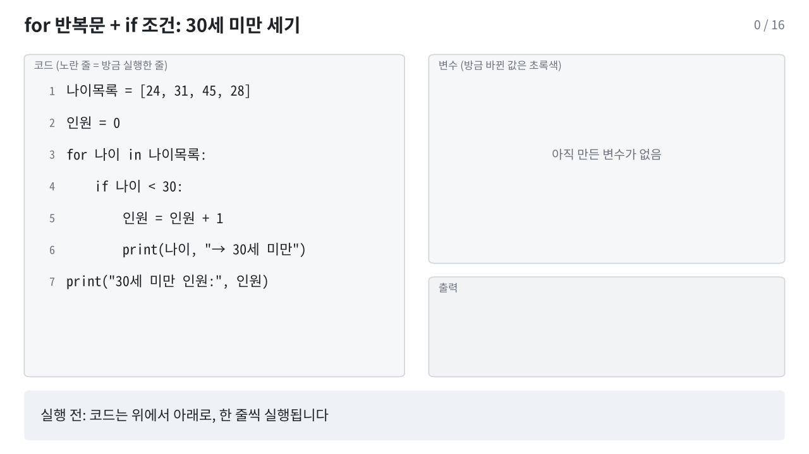

[Colab에서 실습 노트북 열기](https://colab.research.google.com/github/StatJeong/moj-python-lecture/blob/main/notebooks/01_python_basics.ipynb)

이 장에서는 데이터 분석에 필요한 파이썬 문법을 익힙니다. 값의 종류(자료형), 계산(연산자), 여러 값을 묶는 방법(리스트, 딕셔너리), 조건에 따라 다르게 처리하기(조건문), 같은 일을 반복하기(반복문) 순서로 진행합니다.

## 1.1 Colab 사용법

Colab 노트북은 코드 칸(셀)과 글 칸으로 이루어져 있습니다. 코드 칸을 누르고 `Shift + Enter`를 누르면 그 칸이 실행되고 결과가 바로 아래에 나옵니다.

```{python}
print("안녕하세요")
print(1 + 2)
```

`#` 뒤에 쓴 내용은 주석입니다. 실행되지 않고, 코드에 메모를 남길 때 씁니다.

```{python}
# 이 줄은 실행되지 않습니다
print("주석 다음 줄은 실행됩니다")
```

칸의 마지막 줄이 값이면 `print()` 없이도 그 값이 출력됩니다.

```{python}
3 * 4
```

## 1.2 변수

변수는 값에 이름을 붙여 저장해 두는 것입니다.

```{python}
수용번호 = 1001
나이 = 24
죄명 = "절도"
print(수용번호, 나이, 죄명)
```

- `=`는 "같다"는 뜻이 아니라 오른쪽 값을 왼쪽 이름에 저장한다는 뜻입니다.
- 변수 이름에는 한글을 쓸 수 있습니다. 숫자로 시작할 수 없고 띄어쓰기도 안 되므로, 띄어 쓰고 싶으면 밑줄을 씁니다(`형기_개월`).
- 이미 있는 변수에 다시 저장하면 값이 바뀝니다.

```{python}
나이 = 나이 + 1
print(나이)
```

## 1.3 자료형

값에는 종류가 있습니다. 데이터를 다룰 때 가장 많이 쓰는 네 가지는 다음과 같습니다.

| 자료형 | 이름 | 예 | 교정 데이터에서 |
|---|---|---|---|
| `int` | 정수 | `24`, `1001` | 나이, 형기(개월), 수용번호 |
| `float` | 실수 | `126.9` | 수용률 |
| `str` | 문자열 | `"절도"` | 죄명, 시설 이름 |
| `bool` | 참거짓 | `True`, `False` | 직업훈련 참여 여부 |

`type()`으로 값의 종류를 확인할 수 있습니다.

```{python}
나이 = 24
수용률 = 126.9
죄명 = "절도"
직업훈련 = False

print(type(나이))
print(type(수용률))
print(type(죄명))
print(type(직업훈련))
```

문자열은 따옴표로 감쌉니다. `24`는 숫자이고 `"24"`는 글자입니다. 둘은 다른 값입니다.

```{python}
print(24 == "24")
```

## 1.4 연산자

### 산술 연산자

| 연산자 | 뜻 | 예 | 결과 |
|---|---|---|---|
| `+` | 더하기 | `30 + 6` | `36` |
| `-` | 빼기 | `30 - 6` | `24` |
| `*` | 곱하기 | `30 * 2` | `60` |
| `/` | 나누기 | `30 / 12` | `2.5` |
| `//` | 몫 | `30 // 12` | `2` |
| `%` | 나머지 | `30 % 12` | `6` |
| `**` | 거듭제곱 | `2 ** 3` | `8` |

몫(`//`)과 나머지(`%`)를 쓰면 형기 30개월을 "2년 6개월"로 바꿀 수 있습니다.

```{python}
형기_개월 = 30
년 = 형기_개월 // 12
개월 = 형기_개월 % 12
print(년, "년", 개월, "개월")
```

2025년 전국 교정시설의 수용 정원은 50,614명, 1일 평균 수용인원은 63,680명이었습니다(2026 교정통계연보). 수용률을 계산해 봅니다.

```{python}
정원 = 50614
현원 = 63680
수용률 = 현원 / 정원 * 100
print(수용률)
print(round(수용률, 1))
```

곱셈과 나눗셈이 덧셈과 뺄셈보다 먼저 계산됩니다. 먼저 계산할 부분은 괄호로 묶습니다.

```{python}
print(현원 - 정원)                 # 정원을 넘는 인원
print((현원 - 정원) / 정원 * 100)  # 정원 대비 초과 비율(%)
```

### 비교 연산자

비교 연산의 결과는 `True` 또는 `False`입니다.

| 연산자 | 뜻 |
|---|---|
| `==` | 같다 |
| `!=` | 다르다 |
| `>`, `>=` | 크다, 크거나 같다 |
| `<`, `<=` | 작다, 작거나 같다 |

```{python}
나이 = 24
죄명 = "절도"
print(나이 < 30)
print(나이 == 30)
print(죄명 == "사기")
print(죄명 != "사기")
```

`=`는 저장, `==`는 같은지 비교입니다. 처음에 가장 많이 헷갈리는 부분입니다.

### 논리 연산자

| 연산자 | 뜻 |
|---|---|
| `and` | 둘 다 참이면 참 |
| `or` | 하나라도 참이면 참 |
| `not` | 참과 거짓을 뒤집음 |

```{python}
나이 = 24
징벌횟수 = 2
직업훈련 = False

print(나이 < 30 and 징벌횟수 > 0)
print(나이 < 30 or 징벌횟수 > 3)
print(not 직업훈련)
```

### 문자열 연산

문자열끼리 `+`로 이어 붙이고, `*`로 반복할 수 있습니다.

```{python}
시설 = "A" + "교도소"
print(시설)
print("-" * 20)
```

문자열 앞에 `f`를 붙이면 `{ }` 안에 변수 값을 넣을 수 있습니다.

```{python}
print(f"{시설}의 수용률은 {round(수용률, 1)}%입니다")
```

## 1.5 형변환

자료형을 바꿔야 할 때가 있습니다. 엑셀이나 CSV에서 읽은 숫자가 글자로 들어와 있는 경우가 대표적입니다.

```{python}
#| error: true
나이_문자 = "24"
나이_문자 + 1
```

위 칸은 일부러 오류가 나게 만든 코드입니다. 오류 메시지의 마지막 줄을 읽으면 원인을 알 수 있습니다. 여기서는 글자(`str`)와 숫자(`int`)를 더할 수 없다는 뜻입니다. `int()`로 숫자로 바꾸면 계산됩니다.

```{python}
print(int(나이_문자) + 1)
print(str(1001) + "번")
print(float("126.9"))
```

## 1.6 리스트

여러 값을 순서대로 묶을 때는 리스트를 씁니다. 대괄호 `[ ]` 안에 쉼표로 구분해 넣습니다.

```{python}
나이목록 = [24, 31, 45, 28, 52]
print(나이목록)
```

위치(인덱스)로 값을 꺼냅니다. 위치는 0부터 셉니다.

```{python}
print(나이목록[0])    # 첫 번째 값
print(나이목록[1])    # 두 번째 값
print(나이목록[-1])   # 마지막 값
print(나이목록[1:3])  # 두 번째부터 세 번째까지 (3번 위치는 포함하지 않음)
```

리스트에 자주 쓰는 함수입니다.

```{python}
print(len(나이목록))   # 개수
print(sum(나이목록))   # 합계
print(max(나이목록))   # 최댓값
print(min(나이목록))   # 최솟값
print(sum(나이목록) / len(나이목록))  # 평균
```

값을 추가하거나 들어 있는지 확인할 수 있습니다.

```{python}
나이목록.append(37)
print(나이목록)
print(37 in 나이목록)
```

## 1.7 딕셔너리

딕셔너리는 "이름표: 값" 쌍을 묶습니다. 수용자 한 명의 정보를 담기에 알맞습니다.

```{python}
수용자 = {
    "수용번호": 1001,
    "시설": "A교도소",
    "나이": 24,
    "죄명": "절도",
    "징벌횟수": 2,
}
print(수용자["죄명"])
print(수용자["나이"])
```

값을 바꾸거나 새 항목을 추가할 수 있습니다.

```{python}
수용자["징벌횟수"] = 3        # 값 바꾸기
수용자["직업훈련"] = "N"      # 새 항목 추가
print(수용자)
```

표의 한 행은 딕셔너리 하나와 같습니다. 2장에서 다룰 pandas의 표(DataFrame)도 열 이름을 이름표처럼 써서 값을 꺼냅니다.

## 1.8 조건문

조건에 따라 다른 코드를 실행할 때 `if`를 씁니다.

```{python}
나이 = 24

if 나이 < 30:
    print("30세 미만")
elif 나이 < 40:
    print("30대")
else:
    print("40세 이상")
```

- 조건 끝에 콜론(`:`)을 붙입니다.
- 조건이 참일 때 실행할 코드는 4칸 들여 씁니다. 파이썬은 들여쓰기로 어디까지가 `if` 안인지 구분합니다.
- `elif`는 "앞 조건이 거짓이고 이 조건이 참이면", `else`는 "앞의 조건이 모두 거짓이면"이라는 뜻입니다.

```{python}
징벌횟수 = 3

if 징벌횟수 >= 3:
    print("상담 우선 검토")
else:
    print("일반")
```

## 1.9 반복문

리스트의 값을 하나씩 꺼내 같은 작업을 반복할 때 `for`를 씁니다. 형기를 하나씩 더해 합계를 구해 봅니다.

```{python}
형기목록 = [24, 36, 24, 30]
합계 = 0
for 형기 in 형기목록:
    합계 = 합계 + 형기
print("형기 합계:", 합계)
```

아래 움직이는 그림은 위 코드가 한 줄씩 실행되는 과정입니다. 노란 줄이 방금 실행한 줄이고, 오른쪽에 그 결과로 바뀐 변수 값이 초록색으로 표시됩니다.



반복할 때마다 `형기`와 `합계`가 바뀌는 과정을 표로 정리하면 다음과 같습니다.

| 반복 | 꺼낸 값 `형기` | 실행 전 `합계` | 실행 후 `합계` |
|---|---|---|---|
| 1회째 | 24 | 0 | 24 |
| 2회째 | 36 | 24 | 60 |
| 3회째 | 24 | 60 | 84 |
| 4회째 | 30 | 84 | 114 |

`for` 안에 `if`를 넣으면 조건에 맞는 값만 처리할 수 있습니다.

```{python}
나이목록 = [24, 31, 45, 28]
인원 = 0
for 나이 in 나이목록:
    if 나이 < 30:
        인원 = 인원 + 1
        print(나이, "→ 30세 미만")
print("30세 미만 인원:", 인원)
```



정해진 횟수만큼 반복할 때는 `range()`를 씁니다. `range(3)`은 0, 1, 2를 차례로 만듭니다.

```{python}
for i in range(3):
    print(i, "번째 반복")
```

딕셔너리는 `.items()`로 이름표와 값을 함께 꺼낼 수 있습니다.

```{python}
징벌 = {"1001": 2, "1002": 0, "1004": 3}
for 번호, 횟수 in 징벌.items():
    print(번호, "번 징벌", 횟수, "회")
```

## 1.10 함수

자주 하는 계산은 함수로 만들어 두고 이름으로 불러 씁니다. `def`로 만들고 `return`으로 결과를 돌려줍니다.

```{python}
def 수용률계산(현원, 정원):
    return 현원 / 정원 * 100

print(round(수용률계산(1523, 1200), 1))
print(round(수용률계산(1080, 900), 1))
```

지금까지 쓴 `print()`, `len()`, `sum()`, `round()`, `type()`도 파이썬에 미리 만들어져 있는 함수입니다.

## 1.11 연습문제

1. 형기 42개월을 "3 년 6 개월" 형태로 출력하세요.

```{python}
#| eval: false
# 여기에 코드를 작성해 보세요
```

<details>
<summary>정답 보기</summary>

```{python}
형기_개월 = 42
print(형기_개월 // 12, "년", 형기_개월 % 12, "개월")
```

</details>

2. `[24, 31, 45, 28, 52, 37]`의 평균 나이를 구하세요.

```{python}
#| eval: false
# 여기에 코드를 작성해 보세요
```

<details>
<summary>정답 보기</summary>

```{python}
나이목록 = [24, 31, 45, 28, 52, 37]
print(sum(나이목록) / len(나이목록))
```

</details>

3. 같은 나이목록에서 40세 이상인 사람 수를 `for`와 `if`로 세어 보세요.

```{python}
#| eval: false
# 여기에 코드를 작성해 보세요
```

<details>
<summary>정답 보기</summary>

```{python}
인원 = 0
for 나이 in 나이목록:
    if 나이 >= 40:
        인원 = 인원 + 1
print(인원)
```

</details>

4. 아래 딕셔너리에서 나이에 1을 더해 저장한 뒤, f-문자열로 "1003번 수용자는 46세입니다"를 출력하세요.

```{python}
수용자 = {"수용번호": 1003, "나이": 45, "죄명": "사기"}
```

```{python}
#| eval: false
# 여기에 코드를 작성해 보세요
```

<details>
<summary>정답 보기</summary>

```{python}
수용자["나이"] = 수용자["나이"] + 1
print(f"{수용자['수용번호']}번 수용자는 {수용자['나이']}세입니다")
```

</details>
