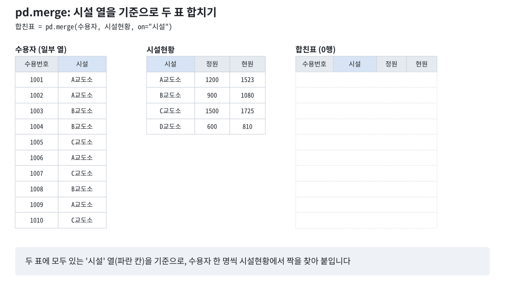

[Colab에서 실습 노트북 열기](https://colab.research.google.com/github/StatJeong/moj-python-lecture/blob/main/notebooks/02_pandas.ipynb)

엑셀처럼 행과 열로 된 표 데이터를 파이썬에서 다룰 때는 pandas를 씁니다. 이 장에서는 수용자 데이터(`inmates.csv`)를 읽고, 원하는 열과 행을 고르고, 집계하고, 다른 표와 합치는 방법을 익힙니다.

## 2.1 데이터 읽기

```{python}
import pandas as pd

주소 = "https://raw.githubusercontent.com/StatJeong/moj-python-lecture/main/data/"
수용자 = pd.read_csv(주소 + "inmates.csv")
수용자
```

::: {.callout-warning title="GitHub 파일은 raw 주소로 읽습니다"}
GitHub 화면 주소(`https://github.com/.../blob/...`)를 그대로 넣으면 웹페이지를 읽으려다 `ParserError: Error tokenizing data`가 납니다. 파일 화면의 `Raw` 버튼을 누르면 나오는 `https://raw.githubusercontent.com/...` 주소를 씁니다.
:::

::: {.callout-note title="import 칸을 먼저 실행하기"}
`NameError: name 'pd' is not defined`가 나면 `import pandas as pd`가 있는 칸을 실행하지 않은 것입니다.
:::

- `import pandas as pd`는 pandas를 불러와 `pd`라는 짧은 이름으로 쓰겠다는 뜻입니다.
- `pd.read_csv()`는 CSV 파일을 읽어 표(DataFrame)로 만듭니다.

내 컴퓨터에 있는 파일을 읽을 때는 Colab 왼쪽의 폴더 아이콘을 눌러 파일을 올린 뒤 파일 이름만 씁니다. 공공기관에서 받은 한글 CSV 파일은 인코딩이 달라서 글자가 깨질 때가 많습니다. 그때는 `encoding="cp949"`를 붙입니다. 엑셀 파일은 `pd.read_excel()`로 읽습니다.

```python
표 = pd.read_csv("내파일.csv", encoding="cp949")
표 = pd.read_excel("내파일.xlsx")
```

::: {.callout-warning title="한글이 깨지거나 UnicodeDecodeError가 날 때"}
공공기관이나 엑셀에서 저장한 CSV는 `cp949`(또는 `euc-kr`) 인코딩인 경우가 많습니다. 그냥 읽으면 `UnicodeDecodeError: 'utf-8' codec can't decode byte ...`가 납니다. `encoding="cp949"`를 붙여 다시 읽습니다.
:::

::: {.callout-warning title="Colab에 올린 파일은 연결이 끊기면 사라집니다"}
왼쪽 폴더 아이콘으로 올린 파일은 임시 공간에 저장됩니다. 연결이 끊기거나 세션을 다시 시작하면 지워지므로 원본은 내 컴퓨터에 두고, 결과 파일은 바로 내려받습니다.
:::

::: {.callout-important title="실제 업무 데이터는 Colab에 올리지 않기"}
Colab은 구글 서버에서 실행됩니다. 실제 수용자 정보가 담긴 파일은 Colab에 올리지 않고, 기관의 내부 분석 환경과 보안 지침을 따릅니다.
:::

## 2.2 데이터 첫 확인

데이터를 읽으면 먼저 생김새를 확인합니다.

```{python}
수용자.head(3)    # 앞의 3행
```

```{python}
수용자.shape      # (행 수, 열 수)
```

```{python}
수용자.columns    # 열 이름
```

```{python}
수용자.dtypes     # 열마다의 자료형
```

`int64`는 정수, `float64`는 실수, `object` 또는 `str`은 문자열입니다. `상담횟수`가 정수가 아니라 실수(`float64`)로 읽힌 이유는 비어 있는 칸이 있기 때문입니다. 이 내용은 2.9절에서 다룹니다.

::: {.callout-warning title="숫자가 문자로 읽히는 경우"}
`"1,234"`처럼 천 단위 쉼표가 들어간 숫자는 문자(`object`)로 읽혀 계산이 되지 않습니다. 읽을 때 `pd.read_csv(..., thousands=",")`를 붙이면 숫자로 읽힙니다. 데이터를 읽은 뒤에는 `dtypes`로 숫자 열이 숫자로 읽혔는지 먼저 확인합니다.
:::

## 2.3 열 고르기

열 하나는 대괄호에 열 이름을 넣어 꺼냅니다. 여러 열은 열 이름 리스트를 넣습니다(대괄호가 두 겹).

```{python}
수용자["나이"]
```

```{python}
수용자[["수용번호", "죄명", "나이"]]
```

::: {.callout-warning title="열 이름은 띄어쓰기까지 정확하게"}
없는 열 이름을 쓰면 `KeyError: '나 이'`처럼 오류가 납니다. 열 이름 앞뒤에 보이지 않는 공백이 붙은 파일도 많습니다. `수용자.columns`로 정확한 이름을 확인하고, 필요하면 `수용자.columns = 수용자.columns.str.strip()`으로 앞뒤 공백을 지웁니다.
:::

::: {.callout-note title="대괄호 한 겹과 두 겹"}
`수용자["나이"]`는 열 하나(Series), `수용자[["나이"]]`는 열 하나짜리 표(DataFrame)입니다. 여러 열을 고를 때는 반드시 두 겹입니다.
:::

::: {.callout-tip title="수용자.나이 처럼 점으로 꺼내기"}
`수용자.나이`도 동작하지만, 열 이름에 띄어쓰기가 있거나 `count`처럼 pandas 기능 이름과 같으면 원하는 열이 나오지 않습니다(`수용자.count`는 열이 아니라 기능). 대괄호 방식을 기본으로 씁니다.
:::

## 2.4 행 고르기 (필터)

조건에 맞는 행만 고를 수 있습니다. 먼저 조건만 써 보면 행마다 `True` / `False`가 나옵니다.

```{python}
수용자["나이"] < 30
```

이것을 다시 대괄호에 넣으면 `True`인 행만 남습니다.

```{python}
수용자[수용자["나이"] < 30]
```

조건 두 개를 함께 쓸 때는 `and` 대신 `&`(그리고), `or` 대신 `|`(또는)를 쓰고 조건마다 괄호를 칩니다.

```{python}
수용자[(수용자["죄명"] == "사기") & (수용자["나이"] >= 40)]
```

::: {.callout-warning title="and 대신 &, 조건마다 괄호"}
```python
수용자[(수용자["나이"] < 30) and (수용자["징벌횟수"] > 0)]
수용자[수용자["나이"] < 30 & 수용자["징벌횟수"] > 0]
```

두 줄 모두 `ValueError: The truth value of a Series is ambiguous...`가 납니다. 첫 줄은 `and`를 써서, 둘째 줄은 괄호가 없어서입니다. `&`는 `<`보다 먼저 계산되므로 조건마다 괄호가 필요합니다.
:::

여러 값 중 하나에 해당하는지는 `isin()`으로 확인합니다.

```{python}
수용자[수용자["죄명"].isin(["폭력", "마약"])]
```

::: {.callout-tip title="일부 글자가 들어 있는 행 찾기"}
`==`는 값이 정확히 같아야 합니다. `"사기 "`처럼 공백이 하나 붙어도 다른 값입니다. 일부 글자가 들어 있는지 확인할 때는 `.str.contains()`를 씁니다.

```python
수용자[수용자["최근상담메모"].str.contains("출소", na=False)]
```

`na=False`는 빈 메모를 거짓으로 처리하라는 뜻입니다. 빠뜨리면 pandas 버전에 따라 `ValueError: Cannot mask with non-boolean array containing NA / NaN values`가 납니다.
:::

## 2.5 정렬

```{python}
수용자.sort_values("징벌횟수", ascending=False).head(3)
```

`ascending=False`는 큰 값부터(내림차순) 정렬한다는 뜻입니다.

::: {.callout-warning title="결과를 다시 저장해야 바뀝니다"}
`수용자.sort_values("나이")`는 정렬된 새 표를 보여줄 뿐, `수용자` 자체는 바뀌지 않습니다. 정렬된 표를 계속 쓰려면 `수용자 = 수용자.sort_values("나이")`처럼 다시 저장합니다. `fillna()`, `dropna()`, `rename()`도 같습니다.
:::

## 2.6 새 열 만들기

열끼리 계산한 결과를 새 열로 저장합니다. 계산은 모든 행에 한꺼번에 적용됩니다.

```{python}
수용자["형기_년"] = 수용자["형기_개월"] / 12
수용자["징벌여부"] = (수용자["징벌횟수"] > 0).astype(int)
수용자[["수용번호", "형기_개월", "형기_년", "징벌횟수", "징벌여부"]]
```

`(수용자["징벌횟수"] > 0)`은 `True` / `False`이고, `.astype(int)`로 1 / 0으로 바꿨습니다.

::: {.callout-warning title="골라낸 표에 새 열을 만들 때 나오는 경고"}
```python
젊은층 = 수용자[수용자["나이"] < 30]
젊은층["표시"] = 1    # SettingWithCopyWarning
```

pandas 버전에 따라 `SettingWithCopyWarning` 경고가 나옵니다. 원래 표(`수용자`)가 함께 바뀌는지 헷갈릴 수 있다는 경고입니다. 골라낸 표를 따로 고쳐 쓸 때는 `.copy()`를 붙입니다.

```python
젊은층 = 수용자[수용자["나이"] < 30].copy()
```
:::

## 2.7 요약하기

```{python}
수용자["나이"].mean()     # 평균
```

```{python}
수용자["죄명"].value_counts()   # 값별 개수
```

::: {.callout-note title="value_counts()는 빈칸을 세지 않습니다"}
`수용자["상담횟수"].value_counts()`의 합은 10이 아니라 9입니다. 빈칸까지 세려면 `value_counts(dropna=False)`를 씁니다.
:::

```{python}
수용자.describe()   # 숫자 열의 요약 통계
```

## 2.8 그룹별 집계

"죄명별 평균 나이", "시설별 징벌 합계"처럼 그룹마다 계산할 때는 `groupby()`를 씁니다.

```{python}
수용자.groupby("죄명")["나이"].mean()
```

```{python}
수용자.groupby("시설")["징벌횟수"].sum()
```

여러 값을 한 번에 구할 때는 `agg()`를 씁니다. `새 열 이름=("대상 열", "계산")` 형태로 적습니다.

```{python}
수용자.groupby("시설").agg(
    인원=("수용번호", "count"),
    평균나이=("나이", "mean"),
    징벌합계=("징벌횟수", "sum"),
)
```

::: {.callout-tip title="집계 결과를 일반 표로 바꾸기"}
`groupby()` 결과는 그룹 이름(시설)이 행 이름(인덱스) 자리에 들어갑니다. 다른 표와 합치거나 저장하려면 `.reset_index()`를 붙여 일반 열로 바꿉니다.

```python
수용자.groupby("시설")["나이"].mean().reset_index()
```
:::

## 2.9 결측치 (비어 있는 값)

```{python}
수용자.isna().sum()     # 열마다 비어 있는 칸 수
```

```{python}
수용자[수용자["상담횟수"].isna()]
```

1007번의 상담횟수와 최근상담메모가 비어 있습니다(`NaN`으로 표시). 평균을 구하면 비어 있는 칸은 빼고 계산합니다.

```{python}
print(수용자["상담횟수"].mean())    # 9명 기준 평균
print(수용자["상담횟수"].count())   # 값이 있는 칸 수
```

빈칸을 0으로 채우고 계산하면 결과가 달라집니다. 0으로 채우는 것은 "상담을 한 번도 하지 않았다"고 가정하는 것이므로, 자료의 사정을 알고 정해야 합니다.

```{python}
print(수용자["상담횟수"].fillna(0).mean())   # 10명 기준 평균
```

::: {.callout-warning title="빈칸은 ==로 찾을 수 없습니다"}
`수용자["상담횟수"] == None`이나 `== float("nan")`으로는 빈칸을 찾지 못합니다(`NaN`은 자기 자신과도 같지 않음). 빈칸은 반드시 `isna()`로 찾습니다.
:::

::: {.callout-note title="빈칸이 있으면 정수 열이 실수가 됩니다"}
상담횟수가 `2.0`, `5.0`처럼 소수점이 붙어 보이는 이유입니다. 빈칸(`NaN`)은 실수로만 표현할 수 있어서 열 전체가 실수가 됩니다.
:::

## 2.10 날짜 다루기

`입소일`은 지금 글자로 들어 있습니다. `pd.to_datetime()`으로 날짜로 바꾸면 연도를 꺼내거나 날짜 계산을 할 수 있습니다.

```{python}
수용자["입소일"] = pd.to_datetime(수용자["입소일"])
수용자["입소일"].dt.year
```

::: {.callout-warning title="날짜 형식이 애매할 때"}
`pd.to_datetime("01/02/2026")`은 1월 2일로 읽힙니다(월/일 순서). 2월 1일이라는 뜻이었다면 틀린 값이 됩니다. 형식을 알 때는 `pd.to_datetime(열, format="%d/%m/%Y")`처럼 직접 지정합니다.

엑셀에서 온 날짜가 `45000` 같은 숫자로 보이면 엑셀 일련번호입니다. `pd.to_datetime(45000, unit="D", origin="1899-12-30")`로 바꾸면 2023-03-15가 됩니다.
:::

입소일에 형기(개월)를 더해 출소예정일을 구합니다. 1장에서 배운 `for` 반복문으로 한 명씩 계산해 리스트에 모은 뒤 새 열로 넣습니다. `zip()`은 두 열에서 값을 한 쌍씩 꺼내 줍니다.

```{python}
출소예정일 = []
for 입소일, 형기 in zip(수용자["입소일"], 수용자["형기_개월"]):
    출소예정일.append(입소일 + pd.DateOffset(months=int(형기)))

수용자["출소예정일"] = 출소예정일
수용자[["수용번호", "입소일", "형기_개월", "출소예정일"]]
```

기준일로부터 출소까지 남은 일수를 구합니다. 기준일은 필요에 맞게 바꿔 씁니다.

```{python}
기준일 = pd.Timestamp("2026-12-01")
수용자["남은일수"] = (수용자["출소예정일"] - 기준일).dt.days
수용자.sort_values("남은일수")[["수용번호", "출소예정일", "남은일수"]].head(3)
```

## 2.11 두 표 합치기 (병합)

시설현황 데이터(`facilities.csv`)를 읽습니다.

```{python}
시설현황 = pd.read_csv(주소 + "facilities.csv")
시설현황
```

두 표에 모두 있는 `시설` 열을 기준으로 합칩니다.

```{python}
합친표 = pd.merge(수용자, 시설현황, on="시설")
합친표[["수용번호", "시설", "정원", "현원"]]
```

::: {.callout-warning title="기준 열의 자료형이 다르면 합쳐지지 않습니다"}
한쪽 표의 수용번호는 숫자(`1001`), 다른 쪽은 글자(`"1001"`)이면 `ValueError: You are trying to merge on int64 and object columns`가 납니다. `dtypes`로 확인하고 `표["수용번호"] = 표["수용번호"].astype(str)`처럼 한쪽에 맞춥니다. 글자끼리라도 `"A교도소 "`처럼 공백이 붙어 있으면 짝을 찾지 못합니다.
:::

::: {.callout-warning title="합친 뒤 행 수를 확인하기"}
상대 표에 같은 키가 두 번 들어 있으면 짝이 두 번씩 붙어 행이 늘어납니다. 시설현황에 A교도소 행이 하나 더 있으면 합친표는 10행이 아니라 14행이 됩니다. 합치기 전과 후에 `len()`으로 행 수를 비교하는 습관을 들입니다.
:::

`pd.merge()`는 수용자 한 명씩 시설현황에서 같은 시설을 찾아 정원과 현원을 붙입니다. 아래 그림이 그 과정입니다.



합친 뒤에는 같은 행에 정원과 현원이 있으므로 수용률을 바로 계산할 수 있습니다.

```{python}
합친표["수용률"] = (합친표["현원"] / 합친표["정원"] * 100).round(1)
합친표[["수용번호", "시설", "수용률"]]
```

D교도소는 수용자 데이터에 없어서 합친표에 나타나지 않습니다. 기준이 되는 표를 바꾸고 `how="left"`를 쓰면 왼쪽 표(시설현황)의 행을 모두 남깁니다. 짝이 없는 D교도소는 수용자 정보가 빈칸(`NaN`)으로 남습니다.

```{python}
print(len(pd.merge(수용자, 시설현황, on="시설")))               # 10행
print(len(pd.merge(시설현황, 수용자, on="시설", how="left")))  # 11행
```

```{python}
pd.merge(시설현황, 수용자, on="시설", how="left")[["시설", "정원", "수용번호", "나이"]].tail(3)
```

## 2.12 함수로 원하는 결과 뽑기

1장에서 만든 함수를 표에 적용하거나, 표를 받아 원하는 결과를 돌려주는 함수를 만들면 같은 분석을 조건만 바꿔 여러 번 할 수 있습니다.

### 열의 값마다 함수 적용하기

`.apply(함수)`는 열의 값 하나하나에 함수를 적용합니다.

```{python}
def 연령대(나이):
    if 나이 < 30:
        return "30세 미만"
    elif 나이 < 40:
        return "30대"
    return "40세 이상"

수용자["연령대"] = 수용자["나이"].apply(연령대)
수용자[["수용번호", "나이", "연령대"]]
```

::: {.callout-note title="apply에는 함수 이름만 넣습니다"}
`수용자["나이"].apply(연령대)`처럼 괄호 없이 함수 이름만 넣습니다. `apply(연령대())`처럼 괄호를 붙이면 그 자리에서 함수를 값 없이 실행하게 되어 `TypeError`가 납니다.
:::

```{python}
수용자["연령대"].value_counts()
```

### 조건을 넣으면 해당 수용자를 돌려주는 함수

열 이름과 값을 넣으면 그 조건에 맞는 행을 돌려줍니다. 2.4절의 필터를 함수로 만든 것입니다.

```{python}
def 수용자찾기(표, 열, 값):
    return 표[표[열] == 값]

수용자찾기(수용자, "죄명", "사기")[["수용번호", "시설", "나이"]]
```

```{python}
수용자찾기(수용자, "경비처우급", "S4")[["수용번호", "시설", "징벌횟수"]]
```

### 시설 이름을 넣으면 요약을 돌려주는 함수

함수 안에서 여러 값을 계산해 딕셔너리로 돌려줍니다.

```{python}
def 시설요약(표, 시설명):
    대상 = 표[표["시설"] == 시설명]
    return {
        "시설": 시설명,
        "인원": len(대상),
        "평균나이": round(float(대상["나이"].mean()), 1),
        "징벌합계": int(대상["징벌횟수"].sum()),
        "직업훈련참여": int((대상["직업훈련"] == "Y").sum()),
    }

시설요약(수용자, "A교도소")
```

반복문으로 시설마다 함수를 부르고, 결과를 모아 표로 만듭니다. `.unique()`는 열에 들어 있는 값을 겹치지 않게 뽑아 줍니다.

```{python}
결과 = []
for 시설명 in 수용자["시설"].unique():
    결과.append(시설요약(수용자, 시설명))

pd.DataFrame(결과)
```

2.8절의 `groupby()`로도 비슷한 표를 만들 수 있습니다. 함수로 만들어 두면 "직업훈련 참여 인원"처럼 원하는 계산을 자유롭게 넣을 수 있고, 다른 데이터에도 그대로 다시 쓸 수 있습니다.

### 기본값이 있는 함수: 출소 예정자 찾기

기준일과 기간에 기본값을 정해 두고, 필요할 때만 바꿔 넣습니다. 2.10절에서 만든 `출소예정일` 열을 씁니다.

```{python}
def 출소예정자(표, 기준일="2026-12-01", 개월=6):
    시작 = pd.Timestamp(기준일)
    끝 = 시작 + pd.DateOffset(months=개월)
    조건 = (표["출소예정일"] >= 시작) & (표["출소예정일"] < 끝)
    return 표[조건][["수용번호", "시설", "출소예정일"]].sort_values("출소예정일")

출소예정자(수용자)                 # 2026-12-01부터 6개월 안
```

```{python}
출소예정자(수용자, 개월=3)         # 기간만 3개월로
```

```{python}
출소예정자(수용자, 기준일="2027-06-01")   # 기준일만 바꿔서
```

## 2.13 결과 저장하기

```{python}
합친표.to_csv("합친표.csv", index=False, encoding="utf-8-sig")
```

::: {.callout-note title="index=False를 빼면"}
맨 앞에 0, 1, 2 ... 번호 열이 함께 저장됩니다. 엑셀에서 열었을 때 이름 없는 열이 하나 더 보이면 이 때문입니다.
:::

`encoding="utf-8-sig"`로 저장해야 엑셀에서 열었을 때 한글이 깨지지 않습니다. Colab에서 저장한 파일은 왼쪽 폴더 아이콘에서 내려받거나 아래 코드로 내려받습니다.

```{python}
#| eval: false
from google.colab import files
files.download("합친표.csv")
```

## 2.14 연습문제

1. 여성 수용자만 골라 수용번호, 나이, 죄명을 보세요.

```{python}
#| eval: false
# 여기에 코드를 작성해 보세요
```

<details>
<summary>정답 보기</summary>

```{python}
수용자[수용자["성별"] == "여"][["수용번호", "나이", "죄명"]]
```

</details>

2. 경비처우급별 평균 징벌횟수를 구하세요.

```{python}
#| eval: false
# 여기에 코드를 작성해 보세요
```

<details>
<summary>정답 보기</summary>

```{python}
수용자.groupby("경비처우급")["징벌횟수"].mean()
```

</details>

3. 직업훈련 참여자(Y)와 비참여자(N)의 평균 상담횟수를 구하세요. 결측치가 있는 1007번은 어느 쪽 계산에서 빠질까요?

```{python}
#| eval: false
# 여기에 코드를 작성해 보세요
```

<details>
<summary>정답 보기</summary>

```{python}
수용자.groupby("직업훈련")["상담횟수"].mean()
```

1007번은 직업훈련 Y이므로 Y쪽 평균은 4명 기준으로 계산됩니다.

</details>

4. 합친표에서 수용률이 125 이상인 시설에 있는 수용자는 몇 명인가요?

```{python}
#| eval: false
# 여기에 코드를 작성해 보세요
```

<details>
<summary>정답 보기</summary>

```{python}
len(합친표[합친표["수용률"] >= 125])
```

</details>

5. 죄명을 넣으면 그 죄명의 인원과 평균 형기(개월)를 딕셔너리로 돌려주는 함수 `죄명요약`을 만들고, 반복문으로 모든 죄명에 적용해 표로 만드세요.

```{python}
#| eval: false
# 여기에 코드를 작성해 보세요
```

<details>
<summary>정답 보기</summary>

```{python}
def 죄명요약(표, 죄명):
    대상 = 표[표["죄명"] == 죄명]
    return {"죄명": 죄명, "인원": len(대상), "평균형기": round(float(대상["형기_개월"].mean()), 1)}

결과 = []
for 죄명 in 수용자["죄명"].unique():
    결과.append(죄명요약(수용자, 죄명))
pd.DataFrame(결과)
```

</details>
