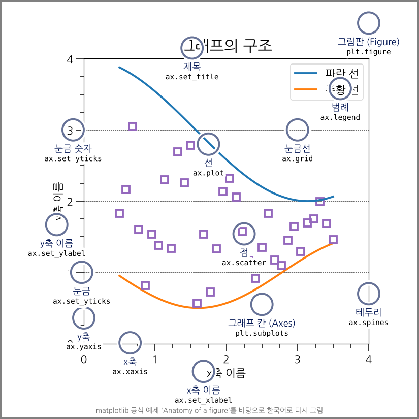
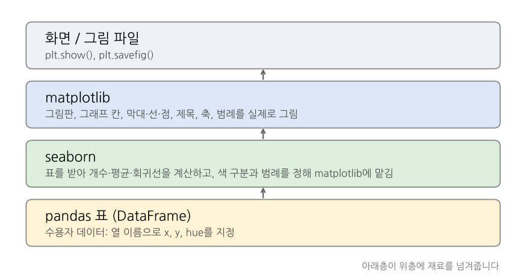
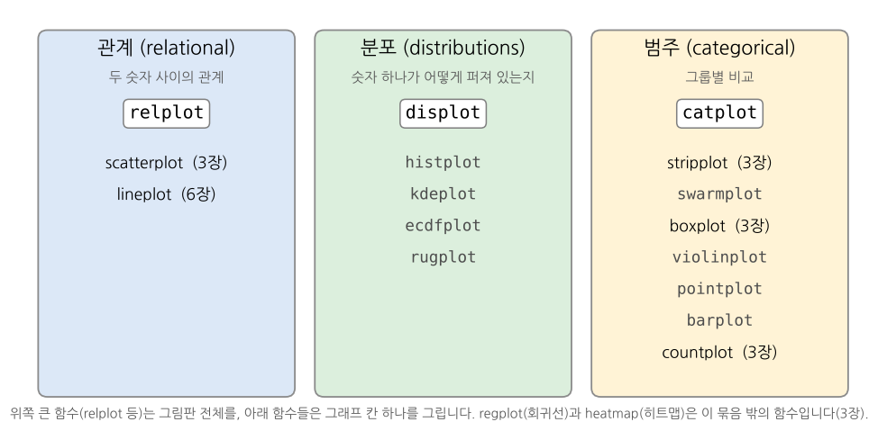

[Colab에서 실습 노트북 열기](https://colab.research.google.com/github/StatJeong/moj-python-lecture/blob/main/notebooks/03_visualization.ipynb)

이 장에서는 먼저 그래프가 어떤 부분으로 이루어지고 어떤 순서로 쌓이는지 살펴본 뒤, matplotlib으로 막대그래프, 히스토그램, 산점도를 그리고, seaborn으로 색 구분, 회귀선, 히트맵을 더한 그래프를 그립니다.

## 3.1 준비

Colab의 기본 설정에서는 그래프의 한글이 네모로 깨집니다. 먼저 나눔고딕 글꼴을 설치합니다. 노트북을 열 때마다 한 번 실행하면 됩니다.

```{python}
!apt-get -qq install -y fonts-nanum > /dev/null
```

설치한 글꼴을 그래프에 쓰도록 설정하고 데이터를 읽습니다.

```{python}
import pandas as pd
import matplotlib.pyplot as plt
from matplotlib import font_manager as fm

fm.fontManager.addfont("/usr/share/fonts/truetype/nanum/NanumGothic.ttf")
plt.rcParams["font.family"] = "NanumGothic"     # 한글 글꼴
plt.rcParams["axes.unicode_minus"] = False      # 음수 부호 깨짐 방지

주소 = "https://raw.githubusercontent.com/StatJeong/moj-python-lecture/main/data/"
수용자 = pd.read_csv(주소 + "inmates.csv")
시설현황 = pd.read_csv(주소 + "facilities.csv")
```

::: {.callout-warning title="한글이 네모(□)로 나올 때"}
- 글꼴 설치 칸과 설정 칸을 그래프보다 먼저 실행했는지 확인합니다.
- 세션을 다시 시작했다면 두 칸을 다시 실행합니다. 설치한 글꼴도 함께 사라집니다.
- 축의 음수 부호만 네모로 나오면 `axes.unicode_minus` 줄을 확인합니다.
:::

Colab 노트북은 장마다 따로 실행되므로, 새 노트북을 열면 데이터를 다시 읽어야 합니다.

## 3.2 그래프의 구조: 층층이 쌓아 그리기

matplotlib 그래프는 한 번에 완성되지 않습니다. 코드 한 줄마다 그림판 위에 요소를 하나씩 쌓아 올려 만듭니다. 그래프 각 부분의 이름과 쌓는 순서를 알아 두면 처음 보는 그래프 코드도 읽을 수 있습니다.

### 그림판과 그래프 칸



| 부분 | 영어 이름 | 만드는 코드 |
|---|---|---|
| 그림판 | Figure | `plt.figure()` |
| 그래프 칸 | Axes | `plt.subplots()` (막대나 선을 그리면 저절로 생기기도 함) |
| 제목 | title | `plt.title()`, `ax.set_title()` |
| x축, y축 이름 | xlabel, ylabel | `plt.xlabel()`, `ax.set_xlabel()` |
| 눈금 | ticks | `plt.xticks()`, `ax.set_xticks()` |
| 막대, 선, 점 | bar, line, marker | `plt.bar()`, `plt.plot()`, `plt.scatter()` |
| 범례 | legend | `plt.legend()` |
| 눈금선 | grid | `plt.grid()` |
| 테두리 | spines | `ax.spines` |

그림판(Figure)은 종이 한 장이고, 그래프 칸(Axes)은 그 종이 위에 그린 그래프 하나입니다. 그림판 하나에 그래프 칸을 여러 개 둘 수도 있습니다(아래 "칸 여러 개 그리기").

원본 그림: [matplotlib 공식 갤러리 Anatomy of a figure](https://matplotlib.org/stable/gallery/showcase/anatomy.html)

### 한 줄씩 층을 쌓는 순서


```{python}
죄명별 = 수용자["죄명"].value_counts()

plt.figure(figsize=(6, 4))                                  # 1. 빈 그림판
plt.bar(죄명별.index, 죄명별.values)                          # 2. 막대 층
plt.axhline(죄명별.mean(), color="gray", linestyle="--")     # 3. 평균선 층
plt.title("죄명별 수용자 수")                                  # 4. 제목
plt.xlabel("죄명")                                           # 5. x축 이름
plt.ylabel("인원(명)")                                       # 6. y축 이름
plt.show()                                                  # 7. 화면에 보여주기
```

Colab에서 칸을 실행하면 모든 줄이 실행된 뒤 완성된 그림 하나만 보입니다. 위 움직이는 그림은 그 사이에 한 줄마다 무엇이 쌓이는지 나눠서 보여준 것입니다.

::: {.callout-tip title="줄을 빼면 그 층만 빠집니다"}
위 칸에서 평균선 줄(`plt.axhline`) 앞에 `#`을 붙여 주석으로 만들고 다시 실행해 보세요. 평균선만 사라지고 나머지는 그대로입니다. 그래프 코드를 받았을 때 줄을 하나씩 빼 보면 그 줄이 어떤 층을 쌓는지 알 수 있습니다.
:::

::: {.callout-note title="나중에 쌓은 층이 위에 보입니다"}
평균선을 막대보다 먼저 그리면 막대에 가려질 수 있습니다. 순서를 바꾸지 않고 앞뒤를 정하려면 `zorder=` 값을 줍니다. 값이 클수록 위에 그려집니다(6장 6.8절에서 막대 위의 흰 점에 사용).
:::

### 두 가지 쓰는 방식: plt 방식과 ax 방식

matplotlib 코드는 두 가지 모양으로 씁니다. 같은 그림을 그리지만 이름이 조금씩 다릅니다.

| 하는 일 | plt 방식 (지금 그리는 칸에) | ax 방식 (칸을 이름으로 잡고) |
|---|---|---|
| 그림판과 칸 만들기 | `plt.figure(figsize=(6, 4))` | `fig, ax = plt.subplots(figsize=(6, 4))` |
| 막대 | `plt.bar(x, y)` | `ax.bar(x, y)` |
| 제목 | `plt.title("제목")` | `ax.set_title("제목")` |
| x축 이름 | `plt.xlabel("이름")` | `ax.set_xlabel("이름")` |
| y축 범위 | `plt.ylim(0, 5)` | `ax.set_ylim(0, 5)` |
| 눈금 | `plt.xticks(...)` | `ax.set_xticks(...)` |
| 범례 | `plt.legend()` | `ax.legend()` |

plt 방식은 짧은 그래프 하나를 그릴 때, ax 방식은 칸이 여러 개이거나 세밀하게 꾸밀 때 씁니다. 6장 6.8절의 연보 도표는 ax 방식으로 그렸습니다. AI가 주는 코드에는 두 방식이 섞여 나오는 경우가 많으니 둘 다 읽을 수 있으면 좋습니다.

### 칸 여러 개 그리기

```{python}
fig, axes = plt.subplots(1, 2, figsize=(10, 4))   # 그림판 하나에 칸 두 개 (1행 2열)

axes[0].bar(죄명별.index, 죄명별.values)           # 왼쪽 칸
axes[0].set_title("죄명별 수용자 수")

axes[1].hist(수용자["나이"], bins=[20, 30, 40, 50, 60], edgecolor="white")   # 오른쪽 칸
axes[1].set_title("나이 분포")

plt.tight_layout()   # 칸 사이 간격을 자동으로 맞춤
plt.show()
```

`axes[0]`, `axes[1]`은 1장 리스트처럼 0부터 세는 칸 번호입니다.

::: {.callout-warning title="두 방식의 이름을 섞으면 오류"}
| 잘못 쓴 코드 | 오류 | 고친 코드 |
|---|---|---|
| `ax.title("제목")` | `TypeError: 'Text' object is not callable` | `ax.set_title("제목")` |
| `plt.set_title("제목")` | `AttributeError: module 'matplotlib.pyplot' has no attribute 'set_title'` | `plt.title("제목")` |

ax 방식은 대부분 이름 앞에 `set_`이 붙습니다(`set_title`, `set_xlabel`, `set_ylim`). 막대·선·점(`bar`, `plot`, `scatter`)과 범례(`legend`)는 두 방식의 이름이 같습니다.
:::

## 3.3 막대그래프: 죄명별 인원

먼저 그릴 값을 만듭니다.

```{python}
죄명별 = 수용자["죄명"].value_counts()
죄명별
```

```{python}
plt.figure(figsize=(6, 4))
plt.bar(죄명별.index, 죄명별.values)
plt.title("죄명별 수용자 수")
plt.xlabel("죄명")
plt.ylabel("인원(명)")
plt.show()
```

| 코드 | 하는 일 |
|---|---|
| `plt.figure(figsize=(6, 4))` | 가로 6, 세로 4 크기의 그림판 만들기 |
| `plt.bar(x, y)` | 막대그래프 그리기 |
| `plt.title()`, `plt.xlabel()`, `plt.ylabel()` | 제목과 축 이름 |
| `plt.show()` | 그림 보여주기 |

::: {.callout-note title="그래프마다 plt.figure()로 시작"}
한 칸에서 `plt.figure()` 없이 그래프를 두 번 그리면 같은 그림 위에 겹쳐 그려집니다. 그래프마다 `plt.figure()`로 새 그림판을 만듭니다.
:::

::: {.callout-tip title="막대 순서 정하기"}
`value_counts()`는 많은 순서로 정렬합니다. 이름 순으로 그리려면 `.sort_index()`를, 원하는 순서가 있으면 `.reindex(["S1", "S2", "S3", "S4"])`처럼 순서를 직접 정합니다.
:::

## 3.4 히스토그램: 나이 분포

숫자 하나의 분포를 볼 때는 히스토그램을 씁니다. `bins`로 구간을 정합니다.

```{python}
plt.figure(figsize=(6, 4))
plt.hist(수용자["나이"], bins=[20, 30, 40, 50, 60], edgecolor="white")
plt.title("수용자 나이 분포")
plt.xlabel("나이")
plt.ylabel("인원(명)")
plt.show()
```

## 3.5 산점도: 상담횟수와 징벌횟수

숫자 두 개의 관계를 볼 때는 산점도를 씁니다.

```{python}
plt.figure(figsize=(6, 4))
plt.scatter(수용자["상담횟수"], 수용자["징벌횟수"])
plt.title("상담횟수와 징벌횟수")
plt.xlabel("상담횟수")
plt.ylabel("징벌횟수")
plt.show()
```

::: {.callout-warning title="그래프에 보이지 않는 값"}
수용자는 10명인데 점은 8개만 보입니다. 1007번은 상담횟수가 비어 있어 빠졌고, 1001번과 1009번은 둘 다 (2, 2)라서 점이 겹쳤습니다. 그래프는 빈칸을 아무 말 없이 빼고 그리고, 같은 위치의 점은 하나로 보입니다. 그래프만 보고 판단하기 전에 데이터를 함께 확인합니다.
:::

## 3.6 시설별 수용률

```{python}
시설현황["수용률"] = (시설현황["현원"] / 시설현황["정원"] * 100).round(1)

plt.figure(figsize=(6, 4))
plt.bar(시설현황["시설"], 시설현황["수용률"])
plt.axhline(100, color="gray", linestyle="--")   # 수용률 100% 기준선
plt.title("시설별 수용률")
plt.ylabel("수용률(%)")
plt.show()
```

## 3.7 집계 결과를 바로 그리기

`groupby()`로 집계한 결과에 `.plot()`을 붙이면 바로 그래프가 됩니다.

```{python}
시설별징벌 = 수용자.groupby("시설")["징벌횟수"].sum()
시설별징벌.plot(kind="bar", figsize=(6, 4), rot=0, title="시설별 징벌횟수 합계")
plt.ylabel("징벌횟수")
plt.show()
```

## 3.8 seaborn으로 그래프 꾸미기

seaborn은 matplotlib 위에서 동작하는 그래프 도구입니다. 표(DataFrame)와 열 이름만 알려주면 색 구분, 범례, 회귀선 같은 것을 알아서 그려 줍니다. Colab에는 이미 설치되어 있습니다.

```{python}
import seaborn as sns

sns.set_theme(style="whitegrid", font="NanumGothic", rc={"axes.unicode_minus": False})
```

::: {.callout-warning title="sns.set_theme()은 한글 글꼴 설정을 지웁니다"}
`sns.set_theme()`을 글꼴 없이 실행하면 3.1절에서 한 글꼴 설정이 기본값으로 돌아가 한글이 다시 네모로 나옵니다. 위처럼 `font="NanumGothic"`을 함께 넣습니다. 이 칸 다음부터 그리는 matplotlib 그래프에도 seaborn 모양이 적용됩니다.
:::

seaborn 함수는 모두 `data=표, x="열 이름", y="열 이름"` 형태로 씁니다.

### seaborn은 matplotlib 위에 쌓인 층



seaborn은 그림을 직접 그리지 않습니다. 표를 받아 개수, 평균, 회귀선 같은 계산을 하고 색과 범례를 정한 다음, 실제 그리기는 matplotlib에 맡깁니다. 그래서 seaborn으로 그린 그래프 위에 3.2절의 matplotlib 명령(`plt.title`, `plt.ylabel`, `plt.axhline` 등)으로 층을 더 쌓을 수 있습니다. 아래 그래프들도 모두 seaborn이 그린 층 위에 matplotlib으로 제목과 축 이름을 더한 것입니다.

seaborn 함수는 하는 일에 따라 세 묶음으로 나뉩니다.



자세한 설명: [seaborn 공식 문서 Overview of seaborn plotting functions](https://seaborn.pydata.org/tutorial/function_overview.html)

::: {.callout-tip title="seaborn 함수는 그린 칸을 돌려줍니다"}
`ax = sns.countplot(data=수용자, x="죄명")`처럼 결과를 받아 두면, 3.2절의 ax 방식(`ax.set_title(...)`, `ax.set_ylabel(...)`)으로 그 칸에 층을 이어서 쌓을 수 있습니다.
:::

### 그룹을 색으로 나눈 막대: countplot

```{python}
plt.figure(figsize=(7, 4))
sns.countplot(data=수용자, x="죄명", hue="시설")
plt.title("죄명별, 시설별 수용자 수")
plt.ylabel("인원(명)")
plt.yticks([0, 1, 2])
plt.show()
```

`hue="시설"`이 시설마다 색을 나누고 범례를 붙입니다. 3.3절처럼 `value_counts()`로 미리 세지 않아도 seaborn이 개수를 셉니다. `sns.countplot()`이 막대 층을 그리고, 그 위에 `plt.title()`, `plt.ylabel()`, `plt.yticks()`가 matplotlib 층을 더 쌓았습니다.

### 상자그림과 점: boxplot + stripplot

```{python}
plt.figure(figsize=(6, 4))
sns.boxplot(data=수용자, x="직업훈련", y="징벌횟수", color="lightgray", showfliers=False)
sns.stripplot(data=수용자, x="직업훈련", y="징벌횟수", color="black", size=8)
plt.title("직업훈련 참여 여부에 따른 징벌횟수")
plt.show()
```

상자는 가운데 50%의 범위와 중앙값을, 검은 점은 수용자 한 명 한 명을 나타냅니다. 4장 4.7절에서 다룰 "직업훈련 N인 5명이 모두 징벌을 받은" 상황이 그림으로 보입니다.

::: {.callout-note title="showfliers=False"}
상자그림은 동떨어진 값을 따로 점으로 찍습니다. 위처럼 점을 따로 겹쳐 그릴 때는 같은 점이 두 번 찍히지 않도록 `showfliers=False`로 끕니다.
:::

### 색과 크기로 정보를 더한 산점도

```{python}
plt.figure(figsize=(7, 4))
sns.scatterplot(data=수용자, x="상담횟수", y="징벌횟수", hue="시설", size="나이", sizes=(60, 400))
plt.title("상담횟수와 징벌횟수 (색: 시설, 크기: 나이)")
plt.legend(bbox_to_anchor=(1.02, 1), loc="upper left")
plt.show()
```

`plt.legend(bbox_to_anchor=(1.02, 1), loc="upper left")`는 범례를 그래프 오른쪽 바깥으로 옮겨 점을 가리지 않게 합니다.

### 회귀선이 있는 산점도: regplot

```{python}
plt.figure(figsize=(6, 4))
sns.regplot(data=수용자, x="상담횟수", y="징벌횟수")
plt.title("상담횟수와 징벌횟수의 관계")
plt.show()
```

직선은 4장 4.5절의 선형회귀선과 같고, 옅은 띠는 그 선의 95% 신뢰구간입니다. 점이 9개뿐이라 띠가 넓습니다.

### 상관계수 히트맵: heatmap

```{python}
상관 = 수용자[["나이", "형기_개월", "상담횟수", "징벌횟수"]].corr().round(2)

plt.figure(figsize=(5, 4))
sns.heatmap(상관, annot=True, cmap="RdBu_r", vmin=-1, vmax=1)
plt.title("숫자 열 사이의 상관계수")
plt.show()
```

`corr()`는 숫자 열끼리의 상관계수(-1 ~ 1)를 표로 계산하고, `heatmap`은 그 표를 색으로 칠합니다. `annot=True`는 칸 안에 숫자를 적습니다.

::: {.callout-note title="10명 자료의 상관계수"}
상담횟수와 징벌횟수의 상관계수가 -0.92로 아주 강하게 나오지만, 강의용으로 만든 10명짜리 가상 자료라서 그렇습니다. 사람 수가 적으면 상관계수가 우연히 크게 나오기 쉽습니다. 상관이 크다고 한쪽이 다른 쪽의 원인이라는 뜻도 아닙니다.
:::

::: {.callout-tip title="어떤 그래프를 그릴 수 있는지 둘러보기"}
- matplotlib 갤러리: <https://matplotlib.org/stable/gallery/index.html>
- seaborn 갤러리: <https://seaborn.pydata.org/examples/index.html>

마음에 드는 그림을 누르면 그 그림을 만든 코드가 함께 나옵니다. 열 이름을 우리 데이터에 맞게 바꾸거나, 그림 주소를 AI에게 주고 "이 예제처럼 수용자 데이터로 그려줘"라고 요청하면 됩니다.
:::

## 3.9 그래프 저장하기

`plt.show()` 앞에 `plt.savefig()`를 넣으면 그림 파일로 저장됩니다. 보고서에 넣을 때는 `dpi`를 150 이상으로 합니다.

```{python}
plt.figure(figsize=(6, 4))
plt.bar(죄명별.index, 죄명별.values)
plt.title("죄명별 수용자 수")
plt.savefig("죄명별_수용자수.png", dpi=150, bbox_inches="tight")
plt.show()
```

::: {.callout-warning title="savefig는 show보다 먼저"}
`plt.show()` 다음에 `plt.savefig()`를 실행하면 빈 그림이 저장됩니다. 그림을 보여주면서 그림판이 닫히기 때문입니다. 저장하는 줄은 항상 `plt.show()` 앞에 둡니다.
:::

::: {.callout-tip title="seaborn 그래프도 같은 방법으로 저장합니다"}
seaborn은 matplotlib 위에서 그리므로 `plt.savefig()`를 그대로 씁니다.
:::

## 3.10 연습문제

1. 경비처우급별 인원을 막대그래프로 그리세요.

```{python}
#| eval: false
# 여기에 코드를 작성해 보세요
```

<details>
<summary>정답 보기</summary>

```{python}
처우급별 = 수용자["경비처우급"].value_counts().sort_index()
plt.figure(figsize=(6, 4))
plt.bar(처우급별.index, 처우급별.values)
plt.title("경비처우급별 인원")
plt.ylabel("인원(명)")
plt.show()
```

</details>

2. 나이와 형기_개월의 관계를 산점도로 그리세요.

```{python}
#| eval: false
# 여기에 코드를 작성해 보세요
```

<details>
<summary>정답 보기</summary>

```{python}
plt.figure(figsize=(6, 4))
plt.scatter(수용자["나이"], 수용자["형기_개월"])
plt.title("나이와 형기")
plt.xlabel("나이")
plt.ylabel("형기(개월)")
plt.show()
```

</details>

3. seaborn으로 경비처우급별 징벌횟수를 상자그림과 점으로 함께 그리세요. 경비처우급은 S1, S2, S3, S4 순서로 놓습니다.

```{python}
#| eval: false
# 여기에 코드를 작성해 보세요
```

<details>
<summary>정답 보기</summary>

```{python}
순서 = ["S1", "S2", "S3", "S4"]
plt.figure(figsize=(6, 4))
sns.boxplot(data=수용자, x="경비처우급", y="징벌횟수", order=순서, color="lightgray", showfliers=False)
sns.stripplot(data=수용자, x="경비처우급", y="징벌횟수", order=순서, color="black", size=8)
plt.title("경비처우급별 징벌횟수")
plt.show()
```

`order=`로 x축의 순서를 정합니다.

</details>
