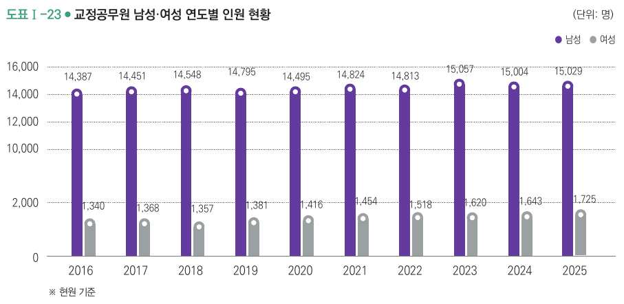
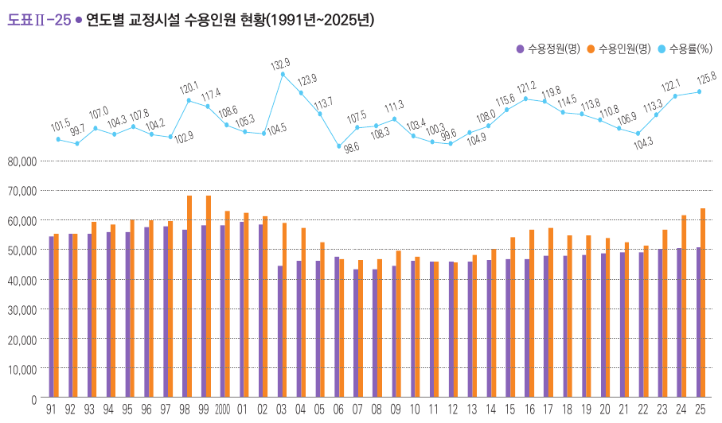
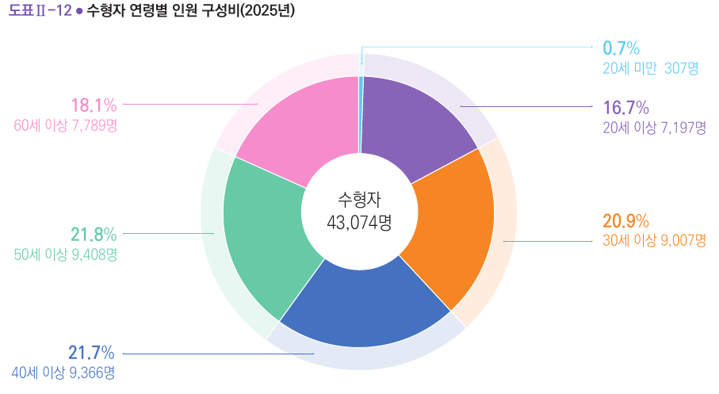
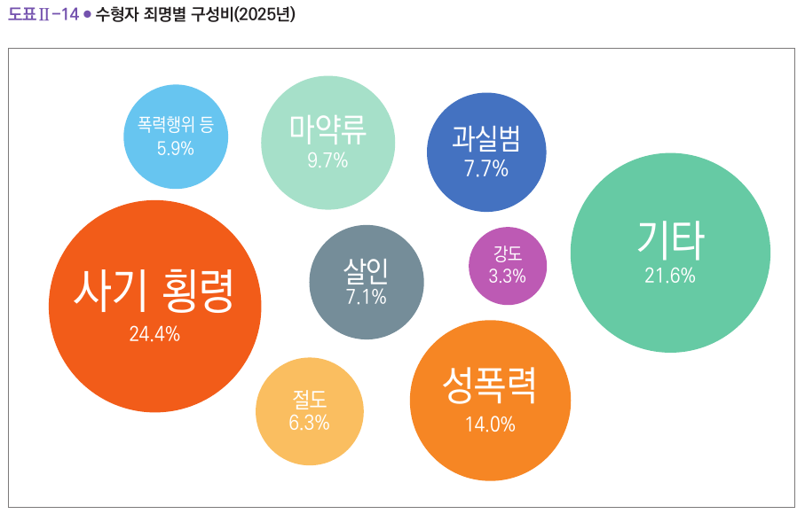

[Colab에서 실습 노트북 열기](https://colab.research.google.com/github/StatJeong/moj-python-lecture/blob/main/notebooks/06_yearbook.ipynb)

이 장에서는 법무부가 공개한 『2026 교정통계연보』의 표를 그대로 옮긴 자료로, 1~5장에서 배운 방법을 실제 숫자에 적용합니다. 수용률 계산 함수, 병합, 반복문, 증가율, 그래프를 다시 씁니다.

## 6.1 자료 소개

| 파일 | 연보 표 | 쪽 | 내용 |
|---|---|---|---|
| `capacity_1991_2025.csv` | 표Ⅱ-13 | 120~121 | 연도별 수용정원, 1일 평균 수용인원, 수용률 (35행) |
| `staff_2016_2025.csv` | 표Ⅰ-15 | 38 | 교정공무원 정원, 현원 (10행) |
| `offense_2016_2025.csv` | 표Ⅱ-9 | 110 | 수형자 죄명별 인원 (10행) |
| `age_2016_2025.csv` | 표Ⅱ-8 | 108 | 수형자 연령별 인원 (10행) |

출처: 이 자료는 『2026 교정통계연보』(법무부 교정본부, 2026) 38쪽, 108쪽, 110쪽, 120~121쪽에서 전재하였습니다. 원문은 교정본부 누리집(www.corrections.go.kr) 알림마당 > 교정통계연보에서 내려받을 수 있습니다.

PDF의 표를 CSV로 옮긴 뒤, 표 안의 합계가 맞는지(예: 죄명별 인원의 합 = 계)를 모두 확인했습니다. 실무에서 PDF나 한글 파일의 표를 옮겨 쓸 때도 이런 확인을 먼저 합니다.

## 6.2 준비

```{python}
!apt-get -qq install -y fonts-nanum > /dev/null
```

```{python}
import pandas as pd
import matplotlib.pyplot as plt
from matplotlib import font_manager as fm

fm.fontManager.addfont("/usr/share/fonts/truetype/nanum/NanumGothic.ttf")
plt.rcParams["font.family"] = "NanumGothic"
plt.rcParams["axes.unicode_minus"] = False

주소 = "https://raw.githubusercontent.com/StatJeong/moj-python-lecture/main/data/yearbook/"
수용 = pd.read_csv(주소 + "capacity_1991_2025.csv")
직원 = pd.read_csv(주소 + "staff_2016_2025.csv")
죄명 = pd.read_csv(주소 + "offense_2016_2025.csv")
연령 = pd.read_csv(주소 + "age_2016_2025.csv")
```

## 6.3 수용률 35년 추이

```{python}
수용.head()
```

```{python}
수용.tail()
```

### 연보의 수용률을 직접 다시 계산하기

1장에서 만든 수용률 함수로 35년치 수용률을 다시 계산하고, 연보에 적힌 값과 같은지 확인합니다. 함수에 열을 통째로 넣으면 모든 행이 한 번에 계산됩니다.

```{python}
def 수용률계산(현원, 정원):
    return round(현원 / 정원 * 100, 1)

수용["수용률_계산"] = 수용률계산(수용["1일평균수용인원"], 수용["수용정원"])
수용[["연도", "수용률", "수용률_계산"]].tail()
```

```{python}
print((수용["수용률_계산"] == 수용["수용률"]).all())
```

35개 연도 모두 같습니다. 공개된 통계라도 이렇게 한 번 다시 계산해 보면, 자료를 옮기다 생긴 실수나 정의의 차이를 찾을 수 있습니다.

### 가장 높았던 해, 정원 이내였던 해

```{python}
수용.loc[수용["수용률"].idxmax()]
```

```{python}
수용[수용["수용률"] < 100][["연도", "수용정원", "1일평균수용인원", "수용률"]]
```

`idxmax()`는 가장 큰 값이 있는 행의 번호를 돌려주고, `loc[]`은 그 번호의 행을 꺼냅니다. 35년 동안 수용률이 100% 아래였던 해는 1992년, 2006년, 2012년 세 해뿐입니다.

### 그래프로 보기

```{python}
plt.figure(figsize=(8, 4))
plt.plot(수용["연도"], 수용["수용률"], marker="o")
plt.axhline(100, color="gray", linestyle="--")
plt.title("교정시설 수용률 (1991~2025년)")
plt.xlabel("연도")
plt.ylabel("수용률(%)")
plt.show()
```

수용률이 가장 높았던 해는 2003년(132.9%)인데, 1일 평균 수용인원이 가장 많았던 해는 1999년(68,087명)입니다. 정원과 수용인원을 함께 그려 보면 이유가 보입니다.

```{python}
plt.figure(figsize=(8, 4))
plt.plot(수용["연도"], 수용["수용정원"], label="수용정원")
plt.plot(수용["연도"], 수용["1일평균수용인원"], label="1일 평균 수용인원")
plt.axvline(2003, color="gray", linestyle=":")
plt.title("수용정원과 1일 평균 수용인원 (1991~2025년)")
plt.xlabel("연도")
plt.ylabel("인원(명)")
plt.legend()
plt.show()
```

2003년에 수용인원은 조금 줄었는데 정원이 58,440명에서 44,350명으로 크게 줄었습니다. 연보(121쪽)에 따르면 2002년 12월 「법무시설기준규칙」의 혼거실 1인당 수용면적 기준이 1.65㎡에서 2.48㎡로 넓어졌기 때문입니다. 수용률의 분모인 정원의 기준이 바뀌었으므로, 2003년 전후의 수용률은 같은 잣대로 비교하기 어렵습니다. 숫자를 비교하기 전에 그 숫자의 정의가 바뀐 적이 있는지 확인해야 합니다.

## 6.4 교정공무원 1인당 수용인원 (병합)

```{python}
직원
```

수용 표와 직원 표를 `연도` 기준으로 합칩니다.

```{python}
합친표 = pd.merge(수용, 직원, on="연도")
합친표["1인당수용인원"] = (합친표["1일평균수용인원"] / 합친표["현원"]).round(2)
합친표[["연도", "1일평균수용인원", "현원", "1인당수용인원"]]
```

수용 표는 35행인데 합친 결과는 10행입니다. 직원 표에 2016년부터의 값만 있어서, 짝이 없는 1991~2015년은 빠졌습니다(2장 2.11절).

```{python}
plt.figure(figsize=(7, 4))
plt.plot(합친표["연도"], 합친표["1인당수용인원"], marker="o")
plt.title("교정공무원 1인당 1일 평균 수용인원")
plt.xlabel("연도")
plt.ylabel("명")
plt.show()
```

### 증가율 함수

2016년과 2025년을 비교하는 증가율 함수를 만듭니다. `iloc[0]`은 첫 행, `iloc[-1]`은 마지막 행입니다(1장 리스트의 위치와 같은 방식).

```{python}
def 증가율(처음, 나중):
    return round((나중 - 처음) / 처음 * 100, 1)

처음 = 합친표.iloc[0]
나중 = 합친표.iloc[-1]
print("1일 평균 수용인원:", 증가율(처음["1일평균수용인원"], 나중["1일평균수용인원"]), "%")
print("수용정원:", 증가율(처음["수용정원"], 나중["수용정원"]), "%")
print("교정공무원 현원:", 증가율(처음["현원"], 나중["현원"]), "%")
```

2016년부터 2025년까지 1일 평균 수용인원은 12.7% 늘었는데, 수용정원은 8.6%, 교정공무원 현원은 6.5% 늘었습니다. 그래서 1인당 수용인원이 3.59명에서 3.80명으로 늘었습니다. 이 값은 현원 기준이고, 행정·의료 인력까지 모두 포함한 수치입니다.

## 6.5 죄명별 구성 변화

```{python}
죄명
```

먼저 옮긴 표가 맞는지 확인합니다. 죄명별 인원을 더하면 '계'와 같아야 합니다.

```{python}
죄명목록 = ["절도", "폭력행위등처벌법", "사기횡령", "성폭력", "마약류", "과실범", "강도", "살인", "기타"]
print((죄명[죄명목록].sum(axis=1) == 죄명["계"]).all())
```

`sum(axis=1)`은 행마다 옆으로 더하라는 뜻입니다.

### 구성비

반복문으로 죄명마다 구성비(%)를 계산해 새 표를 만듭니다.

```{python}
구성비 = pd.DataFrame({"연도": 죄명["연도"]})
for 이름 in 죄명목록:
    구성비[이름] = (죄명[이름] / 죄명["계"] * 100).round(1)
구성비
```

```{python}
plt.figure(figsize=(8, 4))
for 이름 in ["사기횡령", "마약류", "절도"]:
    plt.plot(구성비["연도"], 구성비[이름], marker="o", label=이름)
plt.title("주요 죄명의 구성비 변화 (2016~2025년)")
plt.xlabel("연도")
plt.ylabel("구성비(%)")
plt.legend()
plt.show()
```

### 죄명별 증가율

6.4절의 증가율 함수를 반복문으로 죄명마다 부르고, 결과를 표로 모읍니다.

```{python}
결과 = []
for 이름 in 죄명목록:
    결과.append({
        "죄명": 이름,
        "2016년": 죄명[이름].iloc[0],
        "2025년": 죄명[이름].iloc[-1],
        "증가율": 증가율(죄명[이름].iloc[0], 죄명[이름].iloc[-1]),
    })

증감 = pd.DataFrame(결과).sort_values("증가율")
증감
```

```{python}
plt.figure(figsize=(7, 4))
plt.barh(증감["죄명"], 증감["증가율"])
plt.axvline(0, color="gray")
plt.title("수형자 죄명별 인원 증가율 (2016년 대비 2025년)")
plt.xlabel("증가율(%)")
plt.show()
```

마약류(121.6%)와 과실범(95.3%)이 크게 늘었고, 강도(-43.6%)와 절도(-32.8%)는 줄었습니다. 사기·횡령은 36.3% 늘어 2025년 구성비가 24.4%로 가장 큽니다.

죄명별 표의 '계'(2025년 43,074명)는 6.3절의 1일 평균 수용인원에 들어 있는 수형자 수(2025년 40,564명, 표Ⅱ-1)와 다릅니다. 두 표의 집계 기준이 다른 것으로 보이며 연보에 기준이 따로 적혀 있지 않습니다. 그래서 이 절에서는 인원보다 구성비와 증가율로 비교했습니다.

## 6.6 고령 수형자

```{python}
연령["60세이상_비중"] = (연령["60세이상"] / 연령["계"] * 100).round(1)
연령[["연도", "60세이상", "60세이상_비중"]]
```

```{python}
plt.figure(figsize=(7, 4))
plt.bar(연령["연도"], 연령["60세이상_비중"])
plt.title("수형자 중 60세 이상 비중")
plt.xlabel("연도")
plt.ylabel("비중(%)")
plt.show()
```

```{python}
print("60세 이상 수형자 증가율:", 증가율(연령["60세이상"].iloc[0], 연령["60세이상"].iloc[-1]), "%")
```

60세 이상 수형자는 2016년 3,841명에서 2025년 7,789명으로 두 배 넘게 늘었고, 비중은 10.5%에서 18.1%가 되었습니다.

## 6.7 seaborn으로 한눈에 보기

3장 3.8절의 seaborn으로 연보 자료를 한 장의 그림에 담아 봅니다.

```{python}
import seaborn as sns

sns.set_theme(style="whitegrid", font="NanumGothic", rc={"axes.unicode_minus": False})
```

::: {.callout-warning title="노트북마다 글꼴 설정을 다시"}
Colab 노트북은 장마다 따로 실행되므로, 이 노트북에서도 6.2절의 글꼴 설정과 위의 `font="NanumGothic"`이 모두 필요합니다.
:::

### 죄명 구성비 히트맵

6.5절에서 만든 구성비 표를 연도(가로) x 죄명(세로)으로 돌려 색으로 칠합니다.

```{python}
그림표 = 구성비.set_index("연도").T

plt.figure(figsize=(9, 5))
sns.heatmap(그림표, annot=True, fmt=".1f", cmap="YlOrRd", cbar_kws={"label": "구성비(%)"})
plt.title("수형자 죄명 구성비 (2016~2025년)")
plt.xlabel("연도")
plt.ylabel("")
plt.show()
```

| 코드 | 하는 일 |
|---|---|
| `set_index("연도")` | 연도 열을 행 이름으로 옮김 |
| `.T` | 행과 열을 뒤집음 (연도가 가로, 죄명이 세로) |
| `annot=True, fmt=".1f"` | 칸마다 소수점 한 자리까지 숫자를 적음 |
| `cmap="YlOrRd"` | 값이 클수록 노랑에서 빨강으로 |

사기·횡령 줄이 가장 진하고, 마약류 줄이 오른쪽(최근)으로 갈수록 진해지며, 절도와 강도 줄은 옅어지는 것이 한눈에 보입니다.

::: {.callout-note title="색은 행 사이에서도 비교됩니다"}
히트맵은 표 전체에서 하나의 색 기준을 씁니다. 사기·횡령처럼 큰 값이 있으면 다른 죄명의 변화는 상대적으로 옅게 보입니다. 죄명마다의 변화만 보고 싶으면 6.5절의 증가율 그래프가 더 알맞습니다.
:::

### 연령대별 추이: 긴 표로 바꿔 한 번에 그리기

seaborn은 "연도, 연령대, 인원"처럼 한 행에 값 하나가 있는 긴 표를 받으면 `hue=`로 선을 나눠 한 번에 그립니다. `melt()`가 옆으로 펼쳐진 표를 긴 표로 바꿉니다.

```{python}
연령대목록 = ["20세미만", "20대", "30대", "40대", "50대", "60세이상"]
긴연령 = 연령.melt(id_vars="연도", value_vars=연령대목록, var_name="연령대", value_name="인원")
긴연령.head(8)
```

```{python}
print(len(연령), "행 →", len(긴연령), "행")
```

10개 연도 x 6개 연령대라서 60행이 되었습니다.

```{python}
plt.figure(figsize=(8, 4))
sns.lineplot(data=긴연령, x="연도", y="인원", hue="연령대", marker="o")
plt.title("수형자 연령대별 인원 (2016~2025년)")
plt.legend(bbox_to_anchor=(1.02, 1), loc="upper left")
plt.show()
```

60세 이상은 꾸준히 늘어 2024년부터는 20대보다 많아졌습니다(2025년 60세 이상 7,789명, 20대 7,197명).

::: {.callout-tip title="옆으로 펼친 표와 긴 표"}
엑셀 보고서의 표는 보통 연도가 행, 항목이 열로 펼쳐져 있습니다(옆으로 펼친 표). seaborn처럼 `hue=`로 나눠 그리는 도구는 긴 표를 원합니다. 그래프가 원하는 대로 안 나오면 표 모양부터 확인합니다.
:::

## 6.8 연보 도표 따라 그리기

연보에는 표마다 도표가 함께 실려 있습니다. 같은 자료로 연보와 비슷한 모양의 그래프를 만들어 봅니다. 보고서에 넣을 그래프를 기관 양식에 맞춰 그릴 때 쓰는 방법들입니다.

::: {.callout-note title="원본 도표의 출처"}
이 절의 원본 도표 그림은 『2026 교정통계연보』 39쪽, 109쪽, 111쪽, 121쪽에서 전재하였습니다.
:::

### 준비: 색과 공통 모양을 함수로

```{python}
import numpy as np

sns.set_theme(style="white", font="NanumGothic", rc={"axes.unicode_minus": False})

# 연보 도표에서 뽑은 색
보라, 진보라, 주황, 회색, 하늘 = "#8864B9", "#633B9F", "#F68624", "#9BA1A2", "#4FC3F7"

def 연보스타일(ax, 제목, 단위="명"):
    ax.spines[["top", "right", "left"]].set_visible(False)   # 위, 오른쪽, 왼쪽 테두리 지우기
    ax.grid(axis="y", linestyle=":", color="gray")            # 가로 점선 눈금선
    ax.set_axisbelow(True)                                    # 눈금선을 막대 뒤로
    ax.tick_params(axis="y", length=0)
    ax.yaxis.set_major_formatter("{x:,.0f}")                  # 세 자리마다 쉼표
    ax.set_title(제목, loc="left", fontsize=13, pad=28)
    ax.text(1.0, 1.1, f"(단위: {단위})", transform=ax.transAxes, ha="right", va="bottom", fontsize=9)
```

그래프마다 반복되는 모양(테두리, 점선 눈금, 제목 위치, 단위 표시)을 함수 하나로 묶었습니다. 2장 2.12절처럼 함수로 만들어 두면 모든 그래프를 같은 양식으로 맞출 수 있습니다.

`numpy`(`np`)는 숫자 계산 도구입니다. `np.arange(10)`은 0부터 9까지의 숫자 묶음을 만들고, 이 묶음에서 0.15를 빼면 모든 숫자에서 한꺼번에 빠집니다. 막대 두 개를 나란히 놓을 위치를 계산할 때 씁니다.

### 도표Ⅰ-23: 막대 위에 숫자 적기



```{python}
x = np.arange(len(직원))   # 연도 위치 0, 1, ..., 9
폭 = 0.3

fig, ax = plt.subplots(figsize=(9, 4))
남 = ax.bar(x - 폭 / 2, 직원["남성현원"], 폭, color=진보라, label="남성")
여 = ax.bar(x + 폭 / 2, 직원["여성현원"], 폭, color=회색, label="여성")
ax.scatter(x - 폭 / 2, 직원["남성현원"] - 300, s=10, color="white", zorder=3)   # 막대 끝의 흰 점
ax.scatter(x + 폭 / 2, 직원["여성현원"] - 300, s=10, color="white", zorder=3)
ax.bar_label(남, labels=[f"{v:,}" for v in 직원["남성현원"]], padding=4, fontsize=8)
ax.bar_label(여, labels=[f"{v:,}" for v in 직원["여성현원"]], padding=4, fontsize=8)
ax.set_xticks(x, 직원["연도"])
ax.set_ylim(0, 17000)
연보스타일(ax, "교정공무원 남성·여성 연도별 인원 현황")
ax.legend(loc="lower right", bbox_to_anchor=(1, 1.0), ncol=2, frameon=False, fontsize=9)
plt.show()
```

| 코드 | 하는 일 |
|---|---|
| `fig, ax = plt.subplots(...)` | 그림판(`fig`)과 그 안의 그래프 칸(`ax`)을 함께 만듦. 칸을 이름으로 잡아 두면 세밀하게 고치기 쉬움 |
| `x - 폭 / 2`, `x + 폭 / 2` | 두 막대를 연도 위치의 왼쪽과 오른쪽에 나란히 놓음 |
| `ax.bar_label(막대, labels=...)` | 막대 끝에 숫자를 적음. `f"{v:,}"`는 세 자리마다 쉼표 |
| `zorder=3` | 흰 점을 막대보다 앞에 그림 |

::: {.callout-warning title="원본은 세로축을 중간에서 끊었습니다"}
원본 도표Ⅰ-23의 세로축은 2,000 다음이 바로 10,000입니다. 남성 막대의 아래쪽을 잘라 그렸기 때문에 남성(15,029명)과 여성(1,725명)의 차이(약 8.7배)가 실제보다 작아 보입니다. 위 그래프는 0부터 끊지 않고 그렸습니다. 축을 끊으면 그래프가 보기 좋아지는 대신 크기 비교가 틀어지므로, 보고서에서 축을 끊을 때는 끊었다는 표시를 분명히 해야 합니다.
:::

### 도표Ⅱ-25: 막대와 꺾은선을 한 그래프에



인원(명)과 수용률(%)은 단위가 달라 세로축 하나로는 함께 그릴 수 없습니다. `twinx()`로 같은 가로축을 쓰는 두 번째 세로축을 만들어 꺾은선을 그립니다.

```{python}
x = np.arange(len(수용))
폭 = 0.38

fig, ax1 = plt.subplots(figsize=(11, 5))
ax1.bar(x - 폭 / 2, 수용["수용정원"], 폭, color=보라, label="수용정원(명)")
ax1.bar(x + 폭 / 2, 수용["1일평균수용인원"], 폭, color=주황, label="수용인원(명)")
ax1.set_ylim(0, 125000)                 # 막대를 아래쪽에 두어 위에 꺾은선 자리를 만듦
ax1.set_yticks(range(0, 80001, 10000))

ax2 = ax1.twinx()                       # 두 번째 세로축
ax2.plot(x, 수용["수용률"], color=하늘, marker="o", markersize=4, label="수용률(%)")
for xi, yi in zip(x, 수용["수용률"]):
    ax2.annotate(f"{yi:.1f}", (xi, yi), textcoords="offset points", xytext=(0, 6),
                 ha="center", fontsize=7)
ax2.set_ylim(28, 142)                   # 꺾은선을 위쪽에 둠
ax2.axis("off")                         # 두 번째 세로축의 눈금은 숨김 (원본처럼)

ax1.set_xticks(x, [str(y) if y == 2000 else str(y)[2:] for y in 수용["연도"]], fontsize=8)
연보스타일(ax1, "연도별 교정시설 수용인원 현황(1991년~2025년)", 단위="명, %")

h1, l1 = ax1.get_legend_handles_labels()
h2, l2 = ax2.get_legend_handles_labels()
ax1.legend(h1 + h2, l1 + l2, loc="lower right", bbox_to_anchor=(1, 1.0), ncol=3, frameon=False, fontsize=9)
plt.show()
```

| 코드 | 하는 일 |
|---|---|
| `ax2 = ax1.twinx()` | 가로축은 같고 세로축이 다른 두 번째 그래프 칸 |
| `ax1.set_ylim(0, 125000)` | 막대 칸의 위쪽을 비워 둠. 막대가 아래 60%쯤만 차지함 |
| `ax2.set_ylim(28, 142)` | 수용률이 그래프 위쪽에 오도록 범위를 정함 |
| `ax2.annotate(...)` | 점마다 수용률 값을 적음 |
| `str(y)[2:]` | 1991을 "91"처럼 뒤 두 자리만 표시 (문자열 자르기, 1장 리스트 자르기와 같은 방식) |
| `get_legend_handles_labels()` | 두 칸의 범례를 하나로 합치기 위해 각 칸의 범례 항목을 꺼냄 |

::: {.callout-tip title="두 세로축 그래프를 읽을 때"}
두 세로축 그래프는 범위를 어떻게 정하느냐에 따라 두 선이 겹치거나 떨어져 보입니다. 원본처럼 오른쪽 눈금을 숨기고 점마다 값을 적어 두면, 읽는 사람이 눈금을 잘못 읽을 일이 줄어듭니다.
:::

### 도표Ⅱ-12: 가운데에 합계가 있는 도넛 그래프



```{python}
최근 = 연령[연령["연도"] == 2025].iloc[0]
값 = [최근[c] for c in 연령대목록]
색 = ["#59CAF5", 보라, 주황, "#4472C1", "#66CAA6", "#F68CCB"]

fig, ax = plt.subplots(figsize=(8, 6))
조각, _ = ax.pie(값, colors=색, startangle=90, counterclock=False,
                 wedgeprops={"width": 0.45, "edgecolor": "white"})
ax.text(0, 0, f"수형자\n{최근['계']:,}명", ha="center", va="center", fontsize=14)

for 한조각, 이름, v, c in zip(조각, 연령대목록, 값, 색):
    각도 = np.radians((한조각.theta1 + 한조각.theta2) / 2)   # 조각 가운데 방향
    cx, cy = np.cos(각도), np.sin(각도)
    오른쪽 = cx >= 0
    ax.annotate(f"{v / 최근['계'] * 100:.1f}%\n{이름} {v:,}명",
                xy=(cx * 0.8, cy * 0.8), xytext=(1.5 if 오른쪽 else -1.5, cy * 1.25),
                ha="left" if 오른쪽 else "right", va="center", color=c, fontsize=11,
                arrowprops={"arrowstyle": "-", "color": c})

ax.set_title("수형자 연령별 인원 구성비(2025년)", loc="left", fontsize=13)
plt.show()
```

| 코드 | 하는 일 |
|---|---|
| `ax.pie(값, ...)` | 원그래프. `startangle=90, counterclock=False`는 12시 방향에서 시계 방향으로 그림 |
| `wedgeprops={"width": 0.45}` | 조각의 두께를 줄여 가운데가 빈 도넛 모양으로 만듦 |
| `ax.text(0, 0, ...)` | 가운데에 합계를 적음 |
| `annotate(..., arrowprops=...)` | 조각 밖에 설명을 적고 선으로 이음. 조각 가운데 방향을 각도로 계산해 오른쪽 조각은 오른쪽에, 왼쪽 조각은 왼쪽에 적음 |

::: {.callout-note title="도넛 그래프와 막대그래프"}
도넛(원) 그래프는 전체에서 차지하는 몫을 보여주기 좋지만, 30대(20.9%), 40대(21.7%), 50대(21.8%)처럼 비슷한 조각은 눈으로 크기를 구분하기 어렵습니다. 그래서 원본처럼 조각마다 숫자를 함께 적습니다. 항목끼리의 크기 비교가 목적이면 막대그래프가 더 정확하게 읽힙니다.
:::

## 6.9 AI와 함께 해보기

5장의 방법으로 AI에게 코드를 받아 해결하고, 받은 코드를 한 줄씩 묻고 결과를 확인하세요. 정답 보기에는 확인용 코드가 있습니다.

1. 죄명 구성비를 연도별 100% 누적 막대그래프로 그려 달라고 요청하세요. 막대 하나의 높이가 100이 되는지 확인합니다.

```{python}
#| eval: false
# AI에게 받은 코드를 붙여 넣어 실행해 보세요
```

<details>
<summary>정답 보기</summary>

```{python}
구성비.set_index("연도")[죄명목록].plot(kind="bar", stacked=True, figsize=(9, 5), rot=0)
plt.title("수형자 죄명 구성비 (2016~2025년)")
plt.ylabel("구성비(%)")
plt.legend(bbox_to_anchor=(1.02, 1), loc="upper left")
plt.show()
```

```{python}
print(구성비[죄명목록].sum(axis=1).round(1).tolist())
```

반올림한 구성비를 더하면 해마다 99.8에서 100.2 사이로 나옵니다. 연보 일러두기에도 구성비의 합이 반올림 때문에 100%가 되지 않을 수 있다는 설명이 있습니다.

</details>

2. 6.3절의 수용률 그래프에 2003년 위치에 세로선을 긋고 "수용면적 기준 변경"이라는 글자를 넣어 달라고 요청하세요.

```{python}
#| eval: false
# AI에게 받은 코드를 붙여 넣어 실행해 보세요
```

<details>
<summary>정답 보기</summary>

```{python}
plt.figure(figsize=(8, 4))
plt.plot(수용["연도"], 수용["수용률"], marker="o")
plt.axhline(100, color="gray", linestyle="--")
plt.axvline(2003, color="gray", linestyle=":")
plt.annotate("수용면적 기준 변경", xy=(2003, 132.9), xytext=(2006, 128),
             arrowprops=dict(arrowstyle="->"))
plt.title("교정시설 수용률 (1991~2025년)")
plt.ylabel("수용률(%)")
plt.show()
```

</details>

3. 시작 연도, 끝 연도, 열 이름 목록을 넣으면 열마다 증가율을 표로 돌려주는 함수를 만들어 달라고 요청하세요(5.6절의 요청문 틀 활용). 2016년, 2025년으로 넣었을 때 6.5절의 증가율과 같은지 확인한 뒤, 2021년과 2025년을 비교해 보세요.

```{python}
#| eval: false
# AI에게 받은 함수를 붙여 넣어 실행해 보세요
```

<details>
<summary>정답 보기</summary>

```{python}
def 기간증가율(표, 시작연도, 끝연도, 열목록):
    시작 = 표[표["연도"] == 시작연도].iloc[0]
    끝 = 표[표["연도"] == 끝연도].iloc[0]
    결과 = []
    for 열 in 열목록:
        결과.append({"항목": 열, "시작": 시작[열], "끝": 끝[열], "증가율": 증가율(시작[열], 끝[열])})
    return pd.DataFrame(결과)

기간증가율(죄명, 2021, 2025, 죄명목록)
```

</details>

4. 이 장의 결과를 바탕으로 AI에게 "교정시설 현황 요약" 다섯 문장을 써 달라고 요청하세요. 받은 문장의 숫자를 아래 값과 하나씩 대조합니다.

| 항목 | 값 | 확인한 곳 |
|---|---|---|
| 2025년 수용률 | 125.8% | 6.3절 |
| 2016년 대비 1일 평균 수용인원 증가율 | 12.7% | 6.4절 |
| 2025년 교정공무원 1인당 수용인원 | 3.80명 | 6.4절 |
| 2016년 대비 마약류 수형자 증가율 | 121.6% | 6.5절 |
| 2025년 60세 이상 수형자 비중 | 18.1% | 6.6절 |

5. 연보 111쪽 도표Ⅱ-14처럼 2025년 죄명별 구성비를 크기가 다른 원(버블)으로 그려 달라고 요청하세요. 원본 그림을 설명하거나, AI가 그림을 읽을 수 있으면 캡처를 함께 주면 됩니다. 원을 겹치지 않게 배치하는 부분은 직접 짜기 어려우므로 AI가 어떤 도구를 쓰는지, 그 도구를 설치하는 줄이 무엇인지 물어보세요.



```{python}
#| eval: false
# AI에게 받은 코드를 붙여 넣어 실행해 보세요
```

<details>
<summary>정답 보기</summary>

`circlify`라는 도구가 원의 위치와 크기를 계산해 줍니다. Colab에는 설치되어 있지 않아 먼저 설치합니다.

```{python}
%pip install -q circlify
```

```{python}
import circlify

최근죄명 = 죄명[죄명["연도"] == 2025].iloc[0]
표시이름 = {"폭력행위등처벌법": "폭력행위 등", "사기횡령": "사기·횡령"}
자료 = [{"id": c, "datum": 최근죄명[c] / 최근죄명["계"] * 100} for c in 죄명목록]
원들 = circlify.circlify(자료, show_enclosure=False)

팔레트 = dict(zip(죄명목록, ["#FBBF5E", "#6DC6F0", "#F25C19", "#F68624", "#A6E0CA",
                          "#4472C1", "#C455B4", "#7A8B94", "#66CAA6"]))

fig, ax = plt.subplots(figsize=(7, 7))
ax.axis("off")
끝 = max(max(abs(c.x) + c.r, abs(c.y) + c.r) for c in 원들)
ax.set_xlim(-끝, 끝)
ax.set_ylim(-끝, 끝)
for c in 원들:
    이름, 비율 = c.ex["id"], c.ex["datum"]
    ax.add_patch(plt.Circle((c.x, c.y), c.r * 0.95, color=팔레트[이름]))
    ax.text(c.x, c.y, f"{표시이름.get(이름, 이름)}\n{비율:.1f}%", ha="center", va="center",
            color="white", fontsize=8 + c.r * 22)
ax.set_title("수형자 죄명별 구성비(2025년)", loc="left", fontsize=13)
plt.show()
```

원의 넓이가 구성비에 비례합니다. 원의 배치는 계산할 때마다 같지만 원본과는 다를 수 있습니다.

</details>
